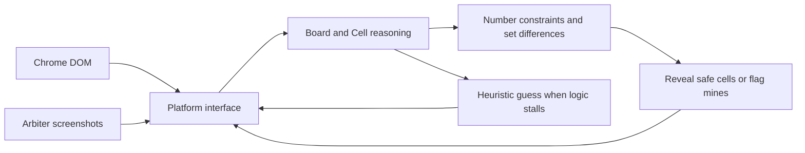

<div align="center">

# Minesweeper Solver

**Watch Python solve Minesweeper in your browser or on your desktop.**

Rule-based reasoning · Fast browser input · Smooth per-click pacing · Bounded retries

[](#quick-start)
[](#choose-your-mode)
[](#desktop-arbiter)

[Quick start](#quick-start) · [Examples](#examples) · [How it works](#how-it-works) · [中文文档](README.zh-CN.md)


<sub>Original browser demo from <a href="https://github.com/h0rban/minesweeper-online-solver">h0rban/minesweeper-online-solver</a>. It illustrates gameplay, not a speed benchmark of this version.</sub>

</div>

## What makes this interesting?

One Python reasoning engine drives two very different interfaces:

- **A browser you can watch.** Play a separate Chrome game without moving your system mouse, or run headless and save the final screenshot.
- **A desktop game read from pixels.** Detect the Arbiter grid, classify its cells, and send guarded mouse and keyboard input.
- **Fast or paced play.** Batch actions for speed, or spread individual clicks toward an approximate game duration.
- **Retries with a shared time budget.** Restart after a confirmed mine hit; stop on success, timeout, cancellation, or an unexpected error.
- **Logic you can inspect.** Small Python modules implement number constraints, set-difference deductions, and heuristic guesses. No LLM or API key is required.

This is a solver and automation project. It can lose when it guesses. It is not a guaranteed solver or a tool for producing valid human competition records.

## Quick start

The commands below use **Windows PowerShell**, Python **3.11**, and an installed **Google Chrome**. Windows is the validated development environment; other operating systems have not been validated. Arbiter mode is Windows-only.

### 1. Install

```powershell
git clone https://github.com/joshuaburgen/minesweeper-online-solver.git
cd minesweeper-online-solver
python -m venv .venv
.\.venv\Scripts\python.exe -m pip install -r requirements.txt
```

No environment activation is needed. Selenium Manager locates a matching ChromeDriver; its first run may need a download. The legacy `chromedriver` file in this checkout is not used automatically.

### 2. Watch a game

```powershell
.\.venv\Scripts\python.exe -u Runner.py --platform web --difficulty 1 --show-browser --seconds 60
```

A **separate Chrome window** opens at [minesweeperonline.com](https://minesweeperonline.com/). The solver reveals cells and flags mines without controlling your system mouse. Startup has no countdown by default.

On completion or a stop, the browser stays open for review. Press **Enter in the terminal** to close it. When the browser remains available, the result is saved to `web_result.png`.

A mine hit is an expected possible outcome. Add `--retry-on-loss` to try another board within the same total time budget.

## Choose your mode

| | Web | Desktop Arbiter |
| --- | --- | --- |
| Target | `minesweeperonline.com` | Minesweeper Arbiter |
| Reads | Visible DOM cell classes | Screenshots and pixel colors |
| Sends | DOM mouse events; optional WebDriver actions | OS mouse and keyboard input |
| System mouse | Stays free | **Moves and clicks** |
| Display | Visible Chrome or headless | Visible, unobstructed game window |
| Default time budget | 180 seconds after browser setup | 15 seconds including setup |
| Result | Site victory indicator and screenshot | Solver cell accounting; no independent victory-indicator check |

`minesweeperonline.com` and `minesweeper.online` are different services. This project does **not** implement the latter's championship. Use automation only where the target service permits it; automated times are not human records.

## Examples

### Fast Expert with retries

Expert is a **16 x 30 board with 99 mines**. Omit the target time for the fastest input mode:

```powershell
.\.venv\Scripts\python.exe -u Runner.py --platform web --difficulty 3 --show-browser --retry-on-loss --seconds 180 --quiet
```

Remove `--show-browser` to run headless. `--quiet` hides per-move logs while retaining the outcome and elapsed time.

### Smooth play toward a target duration

```powershell
.\.venv\Scripts\python.exe -u Runner.py --platform web --difficulty 3 --show-browser --target-seconds 35 --seconds 399 --retry-on-loss --quiet
```

`--target-seconds 35` asks the scheduler to aim for roughly 35 seconds **per game**. It adjusts the interval between individual clicks as progress changes. Pacing waits are capped at 0.5 seconds per input; flood openings do not create a long waiting backlog.

The target is **not a deadline or a promise to win**. Boards can finish earlier or later. Browser commands and OS calls may block; guesses may lose. A completed game is never delayed to make its time look closer to the target.

`--seconds 399` is the separate **total runtime budget across retries**. Restarting does not reset that budget. Leave `--settle` at its default when using target pacing unless you need an additional display-settling delay.

### Desktop Arbiter

Open Minesweeper Arbiter, select the matching difficulty, and press **F2** for a fully covered board. Keep it visible and unobstructed.

```powershell
.\.venv\Scripts\python.exe -u Runner.py --platform arbiter --difficulty 3 --seconds 15 --retry-on-loss --quiet
```

For paced desktop play, add `--target-seconds 35` and give the total budget enough time:

```powershell
.\.venv\Scripts\python.exe -u Runner.py --platform arbiter --difficulty 3 --target-seconds 35 --seconds 120 --retry-on-loss --quiet
```

**Arbiter mode controls the real mouse.** Stop with **Esc**, move the pointer to the **top-left screen corner**, or switch away from Arbiter. Stop checks run before cursor movement and again before a mouse button is pressed. Arbiter is focused once at startup; retries do not steal focus back.

Esc is polled every 20 ms and latched. A stop does not undo input already sent or forcibly interrupt an in-flight OS call. Without a pacing target, up to four inputs can occur before a visual result check; every input still checks cancellation and window ownership.

The default skin is the recognition target. A difficulty mismatch, unexpected cell state, blocked click, or unobserved action stops the run. Retrying sends F2 and verifies the new board; input/recognition errors are not retried as mine hits.

Arbiter is third-party software. The local checkout may contain `arbiter/ms_arbiter.exe`; review its distribution terms before redistributing that binary. The solver can use an already-running Arbiter installation.

<details>
<summary><strong>Optional score-name prompt</strong></summary>

The browser dismisses score-entry prompts by default. Where automated submissions are permitted, `--score-name "YourName"` opts into filling the recognized victory prompt. Names must contain 1-25 characters.

Only the site's recognized score-name prompt receives the name. The runner waits briefly for the normal score request and reports its HTTP status. It does not verify leaderboard placement or bypass the site's rules. Do not use automated scores in human-only competitions.

</details>

## Command reference

```powershell
.\.venv\Scripts\python.exe Runner.py --help
```

| Argument | Default | Purpose |
| --- | --- | --- |
| `--platform arbiter\|web` | `arbiter` | Select the target. Always specify it in scripts. |
| `--difficulty 1\|2\|3` | `3` | Beginner 9 x 9 / 10 mines; intermediate 16 x 16 / 40; expert 16 x 30 / 99. |
| `--seconds N` | Web: `180`; Arbiter: `15` | Shared runtime budget across attempts. |
| `--target-seconds N` | Off | Approximate per-game duration with smooth individual clicks, in either mode. |
| `--retry-on-loss` | Off | Retry confirmed mine hits; stop after success or an interruption. |
| `--show-browser` | Off | Show Chrome and keep it open for review after stopping. Web only. |
| `--settle N` | Web: `0`; Arbiter: `0.02` | Additional settling delay after each action or fast-mode batch. |
| `--delay N` | `0` | Optional startup countdown in whole seconds. |
| `--quiet` | Off | Suppress per-move logs. |
| `--web-input events\|webdriver` | `events` | DOM event input or the slower WebDriver compatibility path. |
| `--score-name NAME` | Off | Opt into the web score-name prompt; subject to site rules. |

Web setup has a separate 60-second cooperative budget. Its play budget starts once the browser is ready. Arbiter's budget includes setup. Time limits are checked cooperatively and may be exceeded by blocking browser, network, or OS operations.

## How it works



1. **Read the visible board.** Both backends expose the same cell-state vocabulary.
2. **Apply number constraints.** Flag the remaining unknown neighbors when they must all be mines; reveal them when all adjacent mines are accounted for.
3. **Compare neighboring constraints.** Set differences identify additional safe cells and mines.
4. **Guess if necessary.** Estimate risk using local mine counts and choose among lower-risk candidates. This is a heuristic, not exact probability enumeration.
5. **Read back the result.** Check the game state before continuing, retrying, or stopping.

Without target pacing, the web backend batches up to 32 operations per browser call. Arbiter batches up to four operations per screenshot and caches cell classification within a frame. Target pacing switches both backends to individual actions.

| File | Responsibility |
| --- | --- |
| `Board.py`, `Cell.py`, `Posn.py` | Game state, deductions, guesses, and coordinates |
| `game_platform.py` | Shared game I/O interface |
| `web_platform.py` | Chrome input, DOM snapshots, reset, and victory handling |
| `arbiter_platform.py` | Desktop I/O, frame caching, batching, and fresh-board checks |
| `arbiter_window.py` | Physical screen capture, coordinates, and guarded OS input |
| `arbiter_geometry.py`, `arbiter_skin.py` | Grid location and cell classification |
| `game_pacer.py`, `run_control.py` | Per-click pacing, shared deadline, and emergency stops |
| `Runner.py` | CLI and retry lifecycle |

## Tests and validation

Run the automated suite without launching a browser or controlling the desktop:

```powershell
.\.venv\Scripts\python.exe -m unittest discover -s . -p "test_*.py" -v
```

The suite covers deductions, synthetic cell recognition, grid detection, batching, per-click pacing, deadline handling, emergency stops, retries, and score-prompt isolation. Native input is mocked and pacing tests use a fake clock. The legacy `tests.py` file is outside this discovery pattern and contains outdated coordinate expectations.

**What has been observed:** earlier live browser runs reached the site's victory state on beginner and expert boards, and a live mine-hit/refresh test produced a fresh expert board. A local browser prompt test did not upload a score.

**What is not established:** no current-version win-rate study or reproducible end-to-end speed benchmark is included. Recent live validation of web target pacing was blocked by `Bad Gateway`; its automated tests pass. Latest Arbiter changes are tested with images and mocked input, not a real desktop speed benchmark. The demo above is not evidence of current performance.

## Troubleshooting

| Symptom | What to check |
| --- | --- |
| Arbiter does not change while web mode runs | Web mode operates a separate Chrome game. Use `--platform arbiter` for the desktop. |
| No Chrome window appears | Add `--show-browser`; headless is the default. |
| `Time limit reached` | The runtime budget expired. Increase `--seconds`; retrying does not extend it. |
| `Hit a mine` | A guess lost. Add `--retry-on-loss` to try another board. |
| Fresh-board or dimension error | Match the game's difficulty to `--difficulty`, then press F2. |
| Desktop input or recognition error | Keep the game visible, use the default skin, and try `--settle 0.05`. |
| `Bad Gateway`, driver download, or Chrome startup error | Check the browser/network setup. Selenium Manager may need internet access; this is separate from solver reasoning. |
| Game finished sooner/later than the target | `--target-seconds` adjusts pacing; it cannot guarantee a duration or a winning board. |

For a read-only Arbiter recognition report, keep the game in the foreground and run:

```powershell
.\.venv\Scripts\python.exe diagnose_arbiter.py --difficulty 3
```

It saves `arbiter_diagnostic/client.png` and `arbiter_diagnostic/report.json` without sending clicks or keys. `calibrate.py 3` is a separate visual calibration helper; the runner detects geometry afresh and does not load old calibration files at startup.

## Contributing

Useful contributions include better risk estimates, fixtures for different DPI settings and skins, and reproducible performance measurements. For a bug report, include the command, Python/Chrome versions, relevant terminal output, and a board screenshot with personal details removed.

Keep reasoning independent of the UI backend, add a regression test for behavior changes, and distinguish measured results from estimates. Open an [issue](https://github.com/joshuaburgen/minesweeper-online-solver/issues) or a [pull request](https://github.com/joshuaburgen/minesweeper-online-solver/pulls).

If this project helps you learn or build something, a star helps other people find it.

## Credits and licensing

This project builds on [Jake Horban's original solver](https://github.com/h0rban/minesweeper-online-solver), including the demo GIF. The original README credits the [Minesweeper strategy guide](http://www.minesweeper.info/wiki/Strategy) as the reasoning inspiration.

Original contributions by Joshua Gax Burgen are available under the [MIT License](LICENSE), copyright 2026. Pre-existing upstream code, the demo, and third-party binaries are not relicensed by that grant. Upstream licensing permission remains unresolved; see [license scope and third-party notices](THIRD_PARTY_NOTICES.md) before redistributing the combined repository.

Maintainers: see [publishing notes](docs/PUBLISHING.md) for the tracked virtual environment, generated files, and release metadata that need attention before sharing a clean repository.
