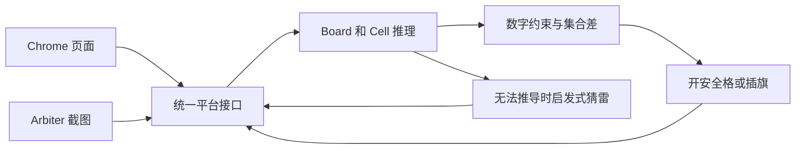

<div align="center">

# Minesweeper Solver

**让 Python 在浏览器或桌面上完成扫雷。**

规则推理 · 网页批量操作 · 逐次点击节奏 · 限时自动重试

[](#快速开始)
[](#选择运行模式)
[](#桌面-arbiter)

[快速开始](#快速开始) · [常用命令](#常用命令) · [工作原理](#工作原理) · [English](README.md)


<sub>演示来自原项目 <a href="https://github.com/h0rban/minesweeper-online-solver">h0rban/minesweeper-online-solver</a>，用于展示玩法，不代表当前版本的速度测试。</sub>

</div>

## 项目特点

同一套 Python 推理代码，驱动两种不同的游戏界面：

- **可以观看的网页扫雷**：打开独立 Chrome 窗口，也可以后台运行，不移动系统鼠标，结束后保存截图。
- **从截图读取桌面棋盘**：定位 Arbiter 网格，按像素颜色识别格子，再发送带停止检查的鼠标、键盘输入。
- **快速运行或按目标时间操作**：不设置目标时间时批量操作；设置后将等待分散到每次点击。
- **所有重试共用总时限**：踩雷后可自动开新局，成功、超时、取消或出现异常时停止。
- **可阅读、可测试的推理逻辑**：数字约束、集合差推导和启发式猜雷，不需要大模型或 API Key。

这是一个扫雷求解与自动化项目。无法推导时仍会猜雷，因此不能保证每局获胜；自动化成绩也不能当作人类比赛纪录。

## 快速开始

以下命令面向 **Windows PowerShell**，需要 **Python 3.11** 和已安装的 **Google Chrome**。当前验证环境为 Windows，其他操作系统尚未验证；Arbiter 模式仅支持 Windows。

### 1. 安装

```powershell
git clone https://github.com/joshuaburgen/minesweeper-online-solver.git
cd minesweeper-online-solver
python -m venv .venv
.\.venv\Scripts\python.exe -m pip install -r requirements.txt
```

无需激活虚拟环境。Selenium Manager 会查找匹配的 ChromeDriver，首次运行可能需要联网下载。仓库中的旧 `chromedriver` 文件不会被自动使用。

### 2. 观看一局

```powershell
.\.venv\Scripts\python.exe -u Runner.py --platform web --difficulty 1 --show-browser --seconds 60
```

程序会打开独立的 Chrome 窗口，在 [minesweeperonline.com](https://minesweeperonline.com/) 上自动开格、插旗。它不控制系统鼠标，也不会操作已打开的 Arbiter 窗口。默认没有启动倒计时。

结束后，浏览器保留供你查看；回到终端按 **Enter** 关闭。浏览器仍可访问时，结果保存为 `web_result.png`。

踩雷可能是正常的猜测失败。加上 `--retry-on-loss`，即可在总时限内尝试新棋盘。

## 选择运行模式

| | 网页模式 | 桌面 Arbiter |
| --- | --- | --- |
| 操作对象 | `minesweeperonline.com` | Minesweeper Arbiter |
| 读取方式 | 页面可见的格子样式 | 截图和像素颜色 |
| 输入方式 | DOM 鼠标事件，也可选择 WebDriver | 系统鼠标、键盘事件 |
| 系统鼠标 | 可以自由使用 | **会移动并点击** |
| 界面要求 | 显示 Chrome 或后台运行 | 游戏可见且无遮挡 |
| 默认总时限 | 浏览器准备好后 180 秒 | 15 秒，包含初始化 |
| 结果判断 | 网站胜利标志和结果截图 | 求解器格子状态统计，未独立校验游戏胜利标志 |

`minesweeperonline.com` 与 `minesweeper.online` 是不同的网站。本项目没有接入后者的 Championship。请只在允许自动化的环境使用，勿将自动化成绩作为人类比赛成绩提交。

## 常用命令

### 快速 Expert，失败后自动重试

Expert 为 **16×30、99 个雷**。不指定目标时间时使用批量加速：

```powershell
.\.venv\Scripts\python.exe -u Runner.py --platform web --difficulty 3 --show-browser --retry-on-loss --seconds 180 --quiet
```

去掉 `--show-browser` 即可后台运行。`--quiet` 隐藏逐步日志，仍显示结果和耗时。

### 把操作分散到目标时间

```powershell
.\.venv\Scripts\python.exe -u Runner.py --platform web --difficulty 3 --show-browser --target-seconds 35 --seconds 399 --retry-on-loss --quiet
```

- `--target-seconds 35`：按**每局约 35 秒**的目标，逐步调整每次点击的间隔。
- `--seconds 399`：**所有重试共用 399 秒总时限**，失败重开不会重新计时。

单次节奏等待最多 0.5 秒；大片自动展开不会积累成长时间停顿。截图、推理和浏览器通信耗时也计入点击间隔。每局重开后重新计算节奏。

目标时间不是截止时间，更不保证获胜。棋盘可能提前完成，也可能因布局、机器性能或猜雷而更慢、失败；获胜后不会为了凑时间继续等待。通常保持 `--settle` 默认值即可，它是额外等待参数。

### 桌面 Arbiter

先打开 Arbiter，选择匹配的难度，按 **F2** 建立全新、未打开的棋盘，并保持窗口可见、无遮挡。

```powershell
.\.venv\Scripts\python.exe -u Runner.py --platform arbiter --difficulty 3 --seconds 15 --retry-on-loss --quiet
```

如果希望按目标节奏操作，可以运行：

```powershell
.\.venv\Scripts\python.exe -u Runner.py --platform arbiter --difficulty 3 --target-seconds 35 --seconds 120 --retry-on-loss --quiet
```

**桌面模式会控制真实鼠标。** 可以通过 **Esc**、将鼠标移到**屏幕左上角**，或切换离开 Arbiter 来停止。每次移动鼠标前、按下鼠标按钮前都会检查。启动时只切换一次焦点，重试不会重新抢回焦点。

Esc 每 20 毫秒轮询一次，检测到后保持停止状态。已发送的点击无法撤回，阻塞中的系统调用不会被强行终止。不指定目标时间时，每批最多 4 次输入后检查画面，但每次输入仍检查取消和窗口归属。

识别主要针对默认皮肤。难度不匹配、格子状态异常、点击被遮挡或操作未生效时，程序停止。只有确认踩雷才自动重试：按 F2 后检查新棋盘，不把输入或识别错误当作猜雷失败处理。

Arbiter 是第三方软件。本地仓库可能含有 `arbiter/ms_arbiter.exe`，公开分发前需确认其分发条款；求解器也可以连接其他目录中已经运行的 Arbiter。

<details>
<summary><strong>可选：填写成绩弹窗中的名字</strong></summary>

默认取消网页成绩提交弹窗。在允许提交自动化成绩的环境，可以加上 `--score-name "YourName"`，向识别到的胜利成绩弹窗填写名字。名字长度为 1–25 个字符。

程序仅向匹配的成绩弹窗发送名字，等待网站正常请求结束并报告 HTTP 状态；不会声称已经核实上榜，也不会绕过网站规则。请勿用于仅允许人类参赛的排行榜。

</details>

## 参数说明

```powershell
.\.venv\Scripts\python.exe Runner.py --help
```

| 参数 | 默认值 | 作用 |
| --- | --- | --- |
| `--platform arbiter\|web` | `arbiter` | 选择平台；脚本中建议显式指定。 |
| `--difficulty 1\|2\|3` | `3` | 初级 9×9 / 10 雷；中级 16×16 / 40 雷；高级 16×30 / 99 雷。 |
| `--seconds N` | 网页 `180`；桌面 `15` | 所有尝试共用的总运行时限。 |
| `--target-seconds N` | 关闭 | 每局近似目标时长，启用逐次点击节奏；两种平台均支持。 |
| `--retry-on-loss` | 关闭 | 确认踩雷后开新局，成功或中断后停止。 |
| `--show-browser` | 关闭 | 显示网页，停止后保留供查看。 |
| `--settle N` | 网页 `0`；桌面 `0.02` | 每次操作或快速模式批次后的额外等待。 |
| `--delay N` | `0` | 启动前倒计时，单位为整数秒。 |
| `--quiet` | 关闭 | 隐藏逐步日志。 |
| `--web-input events\|webdriver` | `events` | DOM 事件，或较慢的 WebDriver 兼容方式。 |
| `--score-name NAME` | 关闭 | 可选的网页成绩名字，须符合目标网站规则。 |

网页初始化有独立的 60 秒协作式时限，对局计时在浏览器准备好后开始。Arbiter 总时限包含初始化。浏览器、网络或系统调用发生阻塞时，实际退出时间可能超过设置的时限。

## 工作原理



1. **读取可见棋盘**：两个平台提供相同的格子状态描述。
2. **应用数字约束**：剩余未知邻居必须全是雷时插旗；相邻雷已全部找到时打开其他格子。
3. **比较相邻约束**：通过未知格集合的差，进一步推导安全格或雷。
4. **必要时猜测**：根据局部剩余雷数估计风险，选择较低风险的候选格。这是启发式，不是完整概率枚举。
5. **读取操作结果**：确认状态后继续、重试或停止。

不指定目标时间时，网页每次浏览器调用最多处理 32 个格子，桌面每张截图最多处理 4 个格子，并缓存同一截图中的分类结果。指定目标时间后，两种平台都逐次执行操作。

| 文件 | 职责 |
| --- | --- |
| `Board.py`、`Cell.py`、`Posn.py` | 棋盘状态、规则推理、猜雷与坐标 |
| `game_platform.py` | 统一游戏输入输出接口 |
| `web_platform.py` | Chrome 操作、DOM 快照、刷新和胜利处理 |
| `arbiter_platform.py` | 桌面输入输出、截图缓存、批次和新局检查 |
| `arbiter_window.py` | 物理像素截图、坐标换算和系统输入保护 |
| `arbiter_geometry.py`、`arbiter_skin.py` | 网格定位与格子分类 |
| `game_pacer.py`、`run_control.py` | 逐次点击节奏、总时限和紧急停止 |
| `Runner.py` | 命令行入口与重试流程 |

## 测试与验证范围

运行自动测试，不启动浏览器，也不操作真实桌面：

```powershell
.\.venv\Scripts\python.exe -m unittest discover -s . -p "test_*.py" -v
```

测试覆盖规则推理、合成图像识别、网格定位、批量操作、逐次点击节奏、总时限、紧急停止、失败重试和成绩弹窗隔离。系统输入使用模拟对象，节奏测试使用模拟时钟。旧的 `tests.py` 不在此发现模式内，包含过时的坐标断言。

**已有观察**：此前真实网页初级和 Expert 对局到达过网站胜利状态；真实踩雷后刷新验证得到了新的 Expert 棋盘。本地浏览器弹窗测试没有上传成绩。

**尚未建立的结论**：没有当前版本的胜率研究或可复现的整局速度基准。最近网页目标节奏的实网验证被 `Bad Gateway` 阻断，自动测试通过。最新 Arbiter 修改主要通过图像与模拟输入验证，尚无真实桌面速度基准。首页演示不能替代这些验证。

## 常见问题

| 现象 | 排查方式 |
| --- | --- |
| 网页模式运行，Arbiter 没变化 | 网页操作独立 Chrome；桌面需要 `--platform arbiter`。 |
| 看不见 Chrome | 加上 `--show-browser`；默认后台运行。 |
| `Time limit reached` | 总时限已到；提高 `--seconds`，重试不会延长时限。 |
| `Hit a mine` | 可能是正常猜测失败；可启用 `--retry-on-loss`。 |
| 提示新局或尺寸不匹配 | 游戏难度与 `--difficulty` 保持一致，再按 F2。 |
| 桌面操作或识别失败 | 保持窗口可见、无遮挡，使用默认皮肤，尝试 `--settle 0.05`。 |
| `Bad Gateway`、驱动下载或 Chrome 启动错误 | 检查网络和浏览器环境；Selenium Manager 可能需要联网。 |
| 没有按目标时间结束 | 目标参数调节操作节奏，不能保证精确耗时或获胜。 |

要生成只读桌面识别报告，保持游戏在前台并运行：

```powershell
.\.venv\Scripts\python.exe diagnose_arbiter.py --difficulty 3
```

结果保存为 `arbiter_diagnostic/client.png` 和 `arbiter_diagnostic/report.json`，不发送点击或按键。`calibrate.py 3` 是另一种可视校准工具；运行入口启动时重新定位，不读取旧的校准文件。

## 参与贡献

欢迎改进猜雷风险估计、补充不同 DPI 与皮肤的图像样例，以及提供可复现的性能测量。报告问题时，请提供运行命令、Python/Chrome 版本、相关终端输出和移除个人信息后的棋盘截图。

请保持推理逻辑独立于界面平台，为行为修改补充回归测试，并区分实测结果和估计。可以提交 [Issue](https://github.com/joshuaburgen/minesweeper-online-solver/issues) 或 [Pull Request](https://github.com/joshuaburgen/minesweeper-online-solver/pulls)。

如果项目对你学习或开发有帮助，欢迎点一个 Star，让更多人发现它。

## 致谢与许可证

本项目基于 [Jake Horban 的原始求解器](https://github.com/h0rban/minesweeper-online-solver)，演示 GIF 同样来自原项目。原 README 将 [Minesweeper 策略指南](http://www.minesweeper.info/wiki/Strategy) 列为推理灵感来源。

Joshua Gax Burgen 的原创新增贡献采用 [MIT License](LICENSE)，版权年份为 2026。该授权不为上游原始代码、演示文件和第三方二进制重新授予许可。上游许可或重新授权尚未明确，公开分发整个仓库前请阅读[许可范围与第三方声明](THIRD_PARTY_NOTICES.md)。

维护者请阅读[发布说明](docs/PUBLISHING.md)，处理已跟踪的虚拟环境、运行产物和仓库展示信息。
